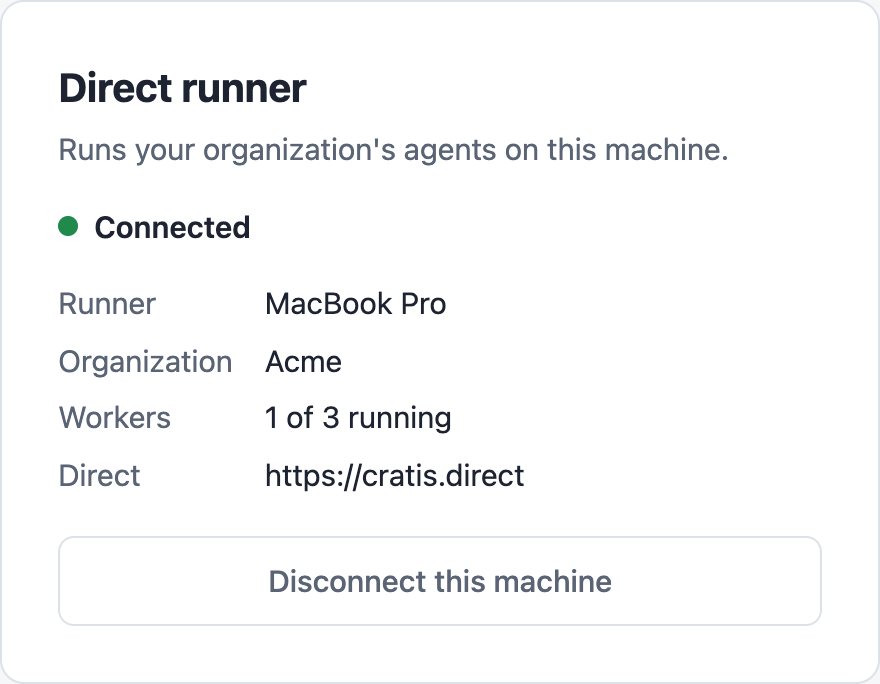
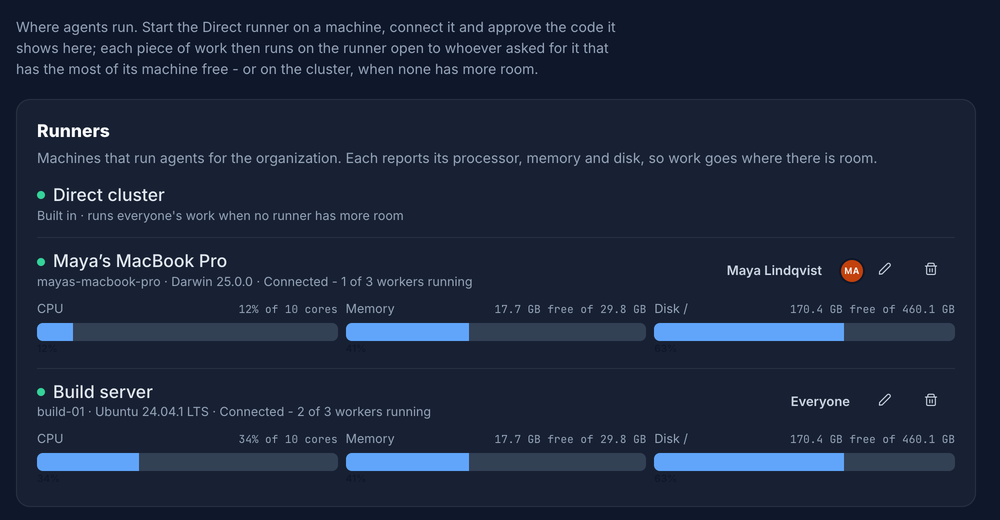

The runner has two places to configure: the **local page** on the machine, which connects it to Direct, and
**Direct's Runners settings**, which decide what the runner is called and whose work it takes. Everything
else is a small set of start-up settings.

## The local page

The runner serves a page at `http://127.0.0.1:7190` on its own machine only. It shows one of these states.

| State | What you see | What you can do |
| --- | --- | --- |
| Not connected | The Direct address and **Connect to Direct** | Connect the runner. |
| Waiting for approval | A code and **Approve in Direct** | Open the approval page, or connect again for a new code. |
| Connecting | **Connecting to Direct...** | Wait. The runner retries with a growing delay of up to one minute. |
| Connected | The runner's name, organization, running workers and Direct address | Disconnect the machine. |
| Not a runner any more | A message that Direct removed the machine | Connect again. |



**Disconnect this machine** makes the machine forget its identity so you can connect it again from scratch. It
does not remove the runner in Direct. Remove it under **Settings → Runners** for that.

## Direct's Runners settings

In Direct, open **Settings → Runners**. The built-in **Direct cluster** is always listed first, followed by
every runner a maintainer approved. Each row shows:

- A green dot when the runner is connected, and its machine, operating system and how many of its workers run.
- Meters for the runner's CPU, memory and the disk its workers use, as it last reported them.
- Who the runner runs for, a pencil to rename it and a bin to remove it.



### Choose who a runner runs for

By default a runner takes work for everyone in the organization. To limit it, select the audience on the
runner's row (for example *Everyone*), pick the people, and select **Save**. Only work those people ask for
runs on the runner. Pick nobody to run everyone's work again.

This is how you keep a personal machine for your own work, or put a shared build machine at a team's disposal.

### Rename a runner

Select the pencil on the runner's row, enter the new name and save. The name is only a label in Direct.

### Remove a runner

Select the bin on the runner's row and confirm. The runner's token stops working at once and it takes no more
work. Work running on it now is not stopped. The local page then shows **Not a runner any more**.

## Start-up settings

The runner reads its settings from command-line arguments and from environment variables. All of them are
optional.

| Setting | Default | What it does |
| --- | --- | --- |
| `Runner:DirectUrl` | `https://cratis.direct` | The Direct to connect to. The local page pre-fills this and you can change it there. |
| `Runner:InterfacePort` | `7190` | The port of the local page. |
| `Runner:RelayPort` | `7191` | The port worker containers call back to Direct through. |
| `Runner:MaximumConcurrentWorkers` | `0` | How many workers run at once. `0` chooses a quarter of the logical cores, and at least one. |
| `Runner:DockerEndpoint` | Docker's platform default | The Docker endpoint, when it is not the default one, such as `unix:///home/me/.docker/run/docker.sock`. |
| `Runner:StateDirectory` | The platform's user configuration folder | Where the runner keeps its identity. |

Pass a setting as an argument:

```shell
direct-runner --Runner:InterfacePort=7290 --Runner:MaximumConcurrentWorkers=2
```

Or as an environment variable. Prefix the name with `DIRECT_RUNNER__` and replace each `:` with `__`:

```shell
export DIRECT_RUNNER__Runner__InterfacePort=7290
export DIRECT_RUNNER__Runner__MaximumConcurrentWorkers=2
direct-runner
```

The runner prints the address of the local page on start, so check it uses the port you set. Both ports
listen on the loopback address only. Change a port when something else on your machine uses it.

> [!NOTE]
> The number of workers also changes what Direct sees. A runner reports its maximum, and Direct sends work to
> the runner with the most of its machine free. Lower the maximum on a machine you also work on.

### Where the runner keeps its identity

The runner stores the identity it connected with in `identity.json` in its state folder. It holds the secret
token the runner uses to connect, so the file is readable by your user only on macOS and Linux. Treat it like a
password.

| System | Default state folder |
| --- | --- |
| macOS | `~/Library/Application Support/direct-runner` |
| Linux | `~/.config/direct-runner` (or `$XDG_CONFIG_HOME/direct-runner`) |
| Windows | `%APPDATA%\direct-runner` |

Deleting the file, or selecting **Disconnect this machine**, makes the runner forget it. You connect and
approve it again, and it becomes a new runner in Direct.
