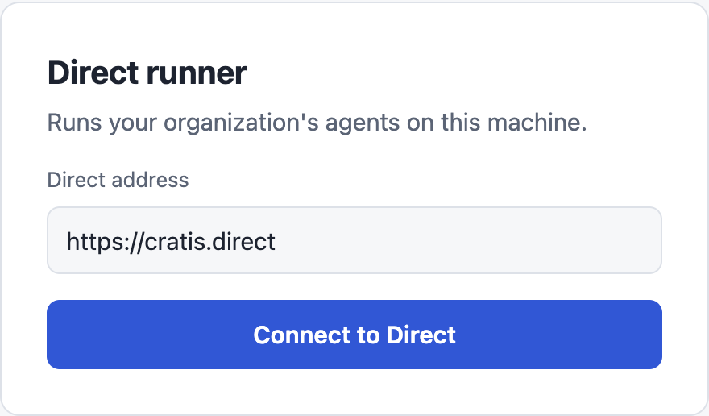
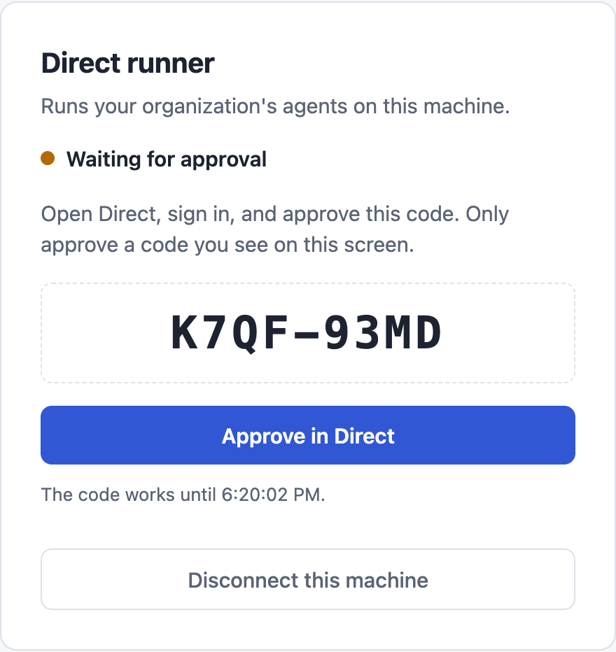
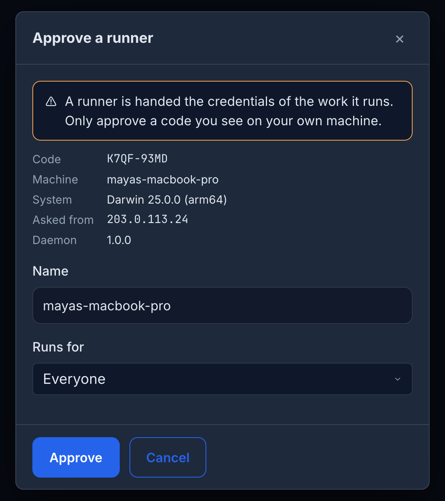
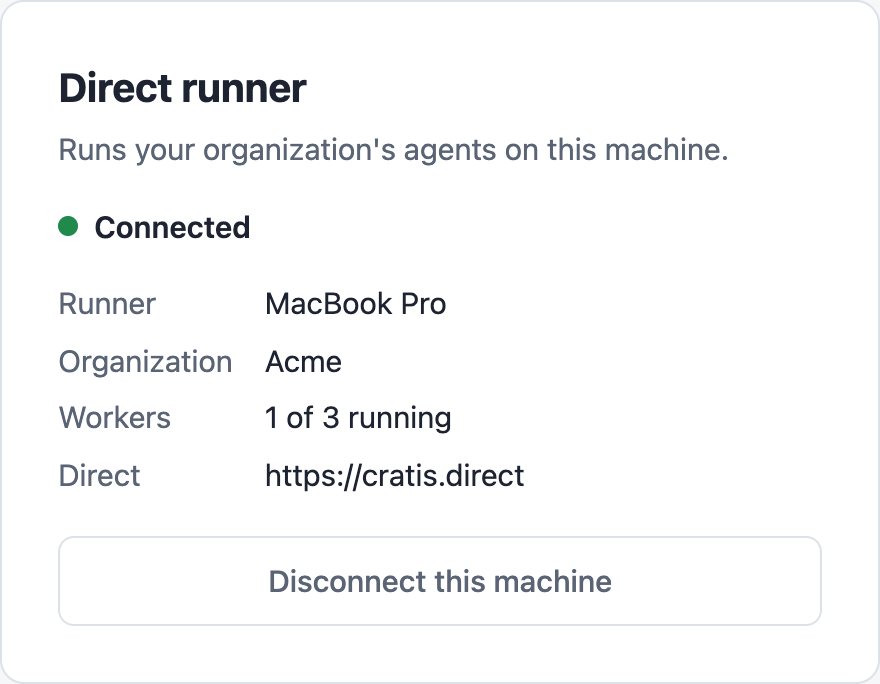
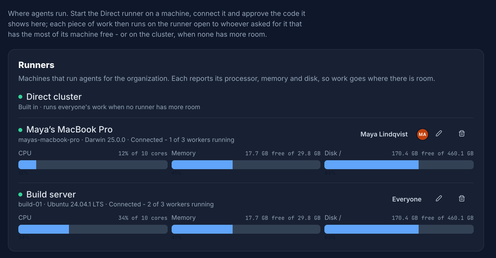

In this tutorial you install the runner, connect it to Direct and approve it. When you finish, your
machine is one of your organization's runners.

## Before you begin

- Docker is installed and running. Check with `docker info`.
- You can sign in to Direct as a maintainer of your organization. Only maintainers can approve a runner.

## 1. Install the runner

Pick the command for your system. Other options, including downloading the binary and starting the runner
at login, are in [Install the runner](./installing.md).

**macOS and Linux with Homebrew**

```shell
brew tap cratis/cratis
brew install direct-runner
```

**Windows (PowerShell)**

```powershell
$version = (Invoke-RestMethod https://api.github.com/repos/Cratis/DirectPublic/releases/latest).tag_name.TrimStart('v')
Invoke-WebRequest "https://github.com/Cratis/DirectPublic/releases/download/v$version/direct-runner-$version-win-x64.zip" -OutFile direct-runner.zip
Expand-Archive direct-runner.zip -DestinationPath "$env:LOCALAPPDATA\direct-runner"
```

## 2. Start the runner

```shell
direct-runner
```

On Windows, run `& "$env:LOCALAPPDATA\direct-runner\direct-runner.exe"`.

The runner prints one line and keeps running:

```text
Direct runner 1.0.0 - open http://127.0.0.1:7190 to connect it to Direct
```

## 3. Connect it to Direct

Open [http://127.0.0.1:7190](http://127.0.0.1:7190). The runner's page asks for the address of your Direct.
It is filled in with `https://cratis.direct`. Change it only if your organization runs its own Direct.



Select **Connect to Direct**. The runner asks Direct to approve this machine and shows a code. It also opens
Direct's approval page in a new browser tab.



The code works for a limited time. The page shows when it stops working. If it expires, select **Connect
to Direct** again for a new one.

## 4. Approve it in Direct

In the tab that opened, sign in to Direct if asked. The **Approve a runner** dialog opens, or select **Approve in
Direct** on the runner's page to open it again.



1. Check that the **Code** matches the one on your runner's page, and that **Machine** and **Asked from** are
   yours. Only approve a code you see on your own machine.
2. Change **Name** to something you will recognize. It defaults to the machine's host name.
3. Leave **Runs for** on *Everyone*, or choose the people whose work this runner takes. You can change this later.
4. Select **Approve**.

You can also reach the dialog yourself: in Direct, open **Settings → Runners** and open the link with the code.

## 5. Check that it is connected

Your runner's page changes to **Connected**.



In Direct, **Settings → Runners** lists the runner next to the built-in Direct cluster, with a green dot, its
operating system and how much of its CPU, memory and disk is in use.



From now on, work that Direct schedules for the people your runner runs for starts on your machine whenever it
has the most room. You can watch the worker containers appear with `docker ps`; their names start with
`cratis-ai-agent-`.

## Next steps

- [Start the runner at login](./installing.md#start-the-runner-at-login) so it is there when work arrives.
- [Choose who the runner runs for](./configuring.md#choose-who-a-runner-runs-for) and change its settings.
- [Troubleshooting](./troubleshooting.md) if the page does not say **Connected**.
